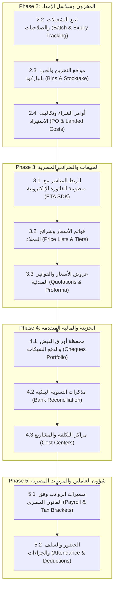

# خطة توسعة وتطوير نظام أوركیفا (Orqiva ERP Expansion Plan & Roadmap)

> **وثيقة مرجعية شاملة** توثق ما تم إنجازه بالكامل من حزم نظام تخطيط موارد المؤسسات (ERP) المتوافق مع متطلبات السوق المصري، وتفصيل كافة المراحل والحزم القادمة للرجوع إليها واستئناف العمل مباشرة.

---

## ١. ملخص المبادئ المعمارية الحاكمة للنظام (System Pillars)

1. **النزاهة المحاسبية بالقرش (Integer Piasters):** جميع المبالغ المالية داخل قاعدة البيانات والعمليات الحسابية تُسجّل كأعداد صحيحة بالقروش (`100 EGP = 10000 piasters`) لمنع أي خطأ تقريب (Float errors).
2. **القيد المزدوج الإلزامي (Strict Double-Entry):** كل حدث مالي ينتج قيد يومية متوازن تلقائياً (`SUM(debit) = SUM(credit)`). القيود المنشورة غير قابلة للتعديل وتصحح حصراً بالقيود العكسية (`REVERSAL`).
3. **عزل الفروع التام (Branch Isolation):** دعم كامل للشركات متعددة الفروع والمخازن مع المحافظة على استقلالية أرصدة المخزون وحسابات الخزائن.
4. **التسعير بالمتوسط المرجح (WAC):** احتساب التكلفة الفعلية للمخزون ومجمل الربح بناءً على حركة الوارد الحقيقية.
5. **معيار عدم التراجع (Zero-Regression):** الحفاظ الدائم على نسبة نجاح 100% لجميع اختبارات التكامل والواجهة.
6. **تجربة مستخدم عربية أصيلة (Arabic-first RTL):** مصطلحات محاسبية دقيقة متوافقة مع البيئة التشغيلية المصرية.

---

## ٢. سجل الإنجازات المعتمدة (Completed Milestones)

### المرحلة الأولى: التأسيس المحاسبي المزدوج (Double-Entry Accounting Core) — [مكتملة 100%]

- [x] **الحزمة 1.1: دفتر الأستاذ العام ومحرك القيود التلقائية (General Ledger Core)**
  - هيكل قيود اليومية (`journal_entries` و `journal_lines`).
  - الترحيل الآلي للمبيعات، المشتريات، المردودات، السندات، المصروفات، التحويلات، وتسويات الجرد.
  - تقرير ميزان المراجعة (Trial Balance) وقائمة الدخل (P&L) والمركز المالي (Balance Sheet) من الأستاذ العام مباشرة.
- [x] **الحزمة 1.2: دليل الحسابات التفاعلي (Interactive Chart of Accounts)**
  - شجرة حسابات هرمية تدعم الفئات الخمس (أصول، خصوم، حقوق ملكية، إيرادات، مصروفات).
  - الطي والفرد الشجري، البحث السريع، واقتراح الكود التالي آلياً.
  - منع حذف الحسابات التي لها حركات محاسبية، وعرض رصيد الحساب اللحظي.
- [x] **الحزمة 1.3: معالج الأرصدة الافتتاحية (Opening Balances Wizard)**
  - شاشة مخصصة لإدخال أرصدة الخزائن والبنوك، العملاء والموردين، وتقييم المخزون الافتتاحي.
  - إقفال القيد المتوازن في حساب الفروق الافتتاحية (`acc_opening_balance`).
  - قفل صارم يمنع تعديل الأرصدة الافتتاحية بمجرد تسجيل قيود وحركات لاحقة.
- [x] **الحزمة 1.4: إقرار ضريبة القيمة المضافة (نموذج 10) وسجل الفواتير الضريبية**
  - استخراج نموذج 10 لضريبة القيمة المضافة المصرية مباشرة من قيود الأستاذ العام (`1150` و `2120`).
  - حصر المبيعات والمشتريات والمردودات الخاضعة لنسبة 14% مع صافي الضريبة المستحقة / الرصيد الدائن.
  - سجل الفواتير الضريبية (Sales & Purchase Tax Registers) مع تتبع حالة الفاتورة الإلكترونية وتصدير Excel/CSV.

### المرحلة الثانية: المخزون وسلاسل الإمداد المتقدمة (Supply Chain Core) — [قيد التنفيذ]

- [x] **الحزمة 2.1: تقرير تقييم المخزون المتقدم والمطابقة مع الأستاذ العام (Stock Valuation & GL Reconciliation)**
  - احتساب قيمة المخزون الفعلي بناءً على المتوسط المرجح (WAC) لكل فرع ولكل المنشأة.
  - حساب القيمة البيعية، الأرباح الكامنة بالمخزون، وهوامش الربح لكل صنف.
  - المطابقة الآلية اللحظية مع حساب بضاعة المخزن بالأستاذ العام (`1140 - acc_inventory`) بالقرش مع شارة المطابقة.
  - كشف وسجل التطور الزمني لتكلفة WAC للصنف الواحد (`CostHistoryModal`).
  - تصدير تقرير التقييم إلى ملف Excel/CSV.
- [x] **الحزمة 2.2: تتبع أرقام التشغيلات وتواريخ الصلاحية (Batch & Expiry Date Tracking - FEFO)**
  - تتبع رقم التشغيلة وتاريخ الإنتاج وتاريخ الصلاحية للدفعات الواردة (`stock_batches`).
  - تطبيق سياسة الصرف الذكية (FEFO: الأقرب انتهاءً يخرج أولاً) تلقائياً عند البيع، مع دعم الاختيار اليدوي.
  - عزل التشغيلات المنتهية الصلاحية ومنع بيعها نهائياً.
  - تبويب تفاعلي للتشغيلات مع 4 بطاقات إحصائيات ملونة وتنبيهات الصلاحية (حرجة < 30 يوم، تحذيرية 30-90 يوم) وتصدير CSV.
  - دعم إدخال التشغيلة في فواتير الشراء وإظهار تلميحات الصرف الذكي في فواتير البيع.

---

## ٣. خارطة الحزم القادمة للعمل عليها مستقبلاً (Upcoming Roadmap)



---

### تفاصيل الحزم المتبقية متطلبات وتنفيذاً:

### الحزمة 2.2: تتبع أرقام التشغيلات وتواريخ الصلاحية (Batch & Expiry Date Tracking)

- **الهدف:** دعم الأنشطة الدوائية، الغذائية، الكيميائية، ومستحضرات التجميل.
- **الجداول المقترحة:**
  - `stock_batches`: `id`, `product_id`, `branch_id`, `batch_number`, `production_date`, `expiry_date`, `quantity`, `cost_price`.
- **المنطق والأعمال:**
  - إلزامية إدخال رقم التشغيلة وتاريخ الصلاحية عند الشراء للأصناف المحددة كـ `track_batch = 1`.
  - سياسة الصرف الذكية: الأقرب انتهاءً يخرج أولاً (**FEFO** - First Expired, First Out) مع إمكانية التحديد اليدوي للتشغيلة عند البيع.
  - تقرير تحذيرات قرب انتهاء الصلاحية (Expired / Near-Expiry alerts: 30 / 60 / 90 يوم).
  - قيود تسوية التالف تلقائياً لمنتجات منتهية الصلاحية لحساب خسائر التالف.

---

### الحزمة 2.3: مواقع التخزين الفرعية داخل المخازن (Warehouse Bins) والجرد بالباركود

- **الهدف:** تنظيم المخازن الكبيرة (ممرات، أرفف، صناديق - Aisle, Rack, Shelf, Bin) وتسريع الجرد الدوري.
- **المكونات:**
  - تعريف شجرة الأماكن داخل المخزن (`warehouse_locations`).
  - تخصيص الأصناف لمواقع محددة وربطها برمز الباركود للموقع.
  - وضع جرد سريع يدعم مسدسات الباركود وهواتف الكاميرا (Mobile barcode scanner mode).
  - مقارنة الرصيد الدفتري بالفعلي وإنشاء قيد تسوية جردية آلي في الأستاذ العام لحساب عجز/زيادة الجرد.

---

### الحزمة 2.4: أوامر الشراء وتكاليف الاستيراد والنقل (PO & Landed Costs Allocation)

- **الهدف:** إدارة دورة المشتريات الخارجية والمحلية بدقة وتوزيع المصروفات الرأسمالية على تكلفة البضاعة.
- **دورة المستند:**
  - أمر شراء (`PURCHASE_ORDER`) ← إذن استلام مخزني (`GOODS_RECEIPT`) ← فاتورة مورد (`PURCHASE_INVOICE`).
- **تحميل التكاليف (Landed Costs):**
  - تسجيل مصاريف الشحن، الجمارك، التخليص، والتفريغ على الشحنة.
  - توزيع التكاليف على الأصناف بحسب (القيمة / الوزن / الكمية).
  - تعديل تكلفة WAC للصنف لتشمل التكلفة الواصلة الحقيقية لحساب تكلفة المبيعات بدقة.

---

### الحزمة 3.1: التكامل الحي مع منظومة الفاتورة والإيصال الإلكتروني (ETA SDK Integration)

- **الهدف:** إرسال الفواتير والإيصالات آلياً إلى بوابة مصلحة الضرائب المصرية بمجرد الحفظ والترحيل.
- **المتطلبات:**
  - دعم التوقيع الإلكتروني (USB Token HSM / Remote Signing Service).
  - تشفير المستند بصيغة Canonical JSON واستخراج كود UUID.
  - الربط مع بيئة التشغيل الفعلي (Production) وبيئة الاختبار (Pre-production).
  - طباعة رمز الاستجابة السريعة القياسي المشفر (QR Code) على إيصالات وفواتير المبيعات.
  - معالجة الحالات والردود من المنظومة (Valid, Invalid, Rejected, Cancelled).

---

### الحزمة 3.2: قوائم الأسعار المتعددة وشرائح العملاء (Price Lists & Customer Tiers)

- **الهدف:** دعم بيع الجملة، نصف الجملة، التجزئة، وتحديد أسعار خاصة لكبار العملاء.
- **المكونات:**
  - قوائم أسعار متعددة (سعر جملة، موزعين، تجزئة).
  - قواعد الخصم الكمي (Bulk Volume Discounts).
  - ربط العميل بقائمة أسعار افتراضية مع إمكانية تعديل السعر وفق الصلاحيات الممنوحة للكاشير/البائع.

---

### الحزمة 3.3: عروض الأسعار والفواتير المبدئية (Quotations & Proforma Invoices)

- **الهدف:** دورة بيع الشركات والمشاريع (B2B Sales Pipeline).
- **دورة المستند:**
  - إنشاء عرض سعر (`QUOTATION`) بصلاحية سريان محددة وتنسيق PDF احترافي للطباعة.
  - تحويل عرض السعر بنقرة واحدة إلى فاتورة مبدئية (`PROFORMA`) أو فاتورة بيع نهائية (`SALE`).
  - تتبع العروض المقبولة والمرفوضة والمنتهية.

---

### الحزمة 4.1: محفظة الشيكات وأوراق القبض والدفع (Cheques & Commercial Papers Portfolio)

- **الهدف:** التحكم الكامل في دورة الشيكات المصرفية المصرية.
- **دورة شيكات القبض:**
  - استلام شيك ← حافظة شيكات تحت التحصيل ← تحصيل بالبنك / ارتداد / تظهير لمورد.
- **دورة شيكات الدفع:**
  - إصدار شيك لمورد ← صرف من البنك / إلغاء.
- **الربط المحاسبي:**
  - استخدام حسابات وسيطة (`1130 - أوراق قبض`، `2130 - أوراق دفع`، `1135 - شيكات برسم التحصيل`).

---

### الحزمة 4.2: مذكرات التسوية البنكية (Bank Reconciliation)

- **الهدف:** مطابقة كشف الحساب البنكي (Bank Statement) مع قيود الأستاذ العام لحسابات البنوك.
- **المكونات:**
  - استيراد كشف الحساب البنكي (Excel / CSV).
  - المطابقة الآلية حسب رقم المرجع والمبلغ والتاريخ (Auto-matching).
  - إظهار شيكات لم تقدم للصرف وإيداعات في الطريق.
  - إعداد مذكرة تسوية بنكية رسمية قابلة للطباعة والمراجعة المحاسبية.

---

### الحزمة 4.3: مراكز التكلفة والمشاريع (Cost Centers & Analytical Accounting)

- **الهدف:** تحليل الإيرادات والمصروفات حسب الأقسام، الفروع، أو المشاريع المنفصلة.
- **المكونات:**
  - دليل مراكز تكلفة شجري مستقل عن دليل الحسابات.
  - إمكانية ربط أي سطر قيد محاسبي بمركز تكلفة.
  - قائمة دخل تفصيلية لكل مركز تكلفة/مشروع لمراقبة ربحية كل فرع أو نشاط تجاري بشكل منفرد.

---

### الحزمة 5.1: مسيرات الرواتب وفق القانون المصري (Egyptian Payroll & Tax Engine)

- **الهدف:** احتساب المرتبات آلياً مع الامتثال الضريبي والتأميني المصري.
- **قواعد الاحتساب:**
  - شرائح ضريبة كسب العمل المصرية المحدثة والحد الأدنى للإعفاء الشخصي.
  - حصة العامل وحصة الشركة في التأمينات الاجتماعية (الأجر التأميني).
  - استقطاعات صندوق الشهداء ورسم التكافل الاجتماعي.
  - توليد قيد استحقاق وصرف المرتبات آلياً في الأستاذ العام.

---

### الحزمة 5.2: الحضور والانصراف، الإجازات، السلف والجزاءات

- **الهدف:** إدارة شؤون العاملين والربط المباشر مع استحقاقات الرواتب.
- **المكونات:**
  - إدارة رصيد الإجازات السنوية والمرضية.
  - متابعة السلف وسدادها على أقساط تخصم تلقائياً من مسير الراتب.
  - تسجيل ساعات العمل الإضافي ومكافآت الأداء أو الجزاءات.

---

## ٤. تعليمات استئناف التطوير للمهندسين (Developer Handoff Guide)

1. **التحقق من البيئة والاختبارات قبل البدء:**
   ```bash
   npm test
   ```
   يجب أن تجتاز جميع ملفات الاختبار (24 ملفاً، 220 اختباراً) بنسبة 100%.
2. **عند البدء في أي حزمة جديدة (مثال: الحزمة 2.2):**
   - راجع قسم الحزمة في هذا الملف واعتمد مخطط قاعدة البيانات والتعديلات على الجداول (`database/migrations/`).
   - اكتب مسارات الخادم والمحركات أولاً مع كتابة اختبارات التكامل الموازية.
   - ابنِ شاشات الواجهة التفاعلية متوافقة مع الـ RTL وأنماط التصميم في `src/styles/features.css`.
   - شغل `npm run format` و `npm test` للتأكد التام من عدم وجود أي خطأ أو تراجع.
